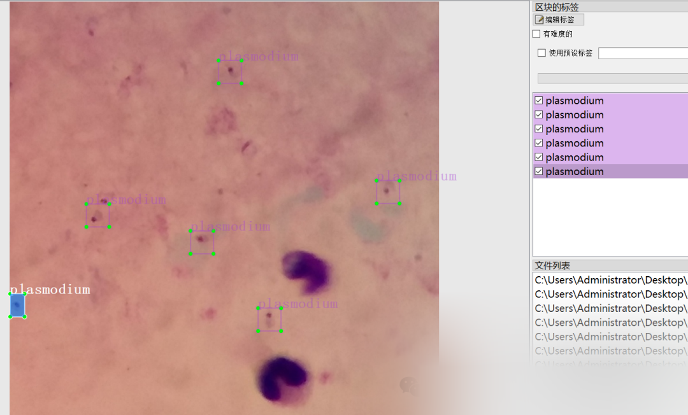
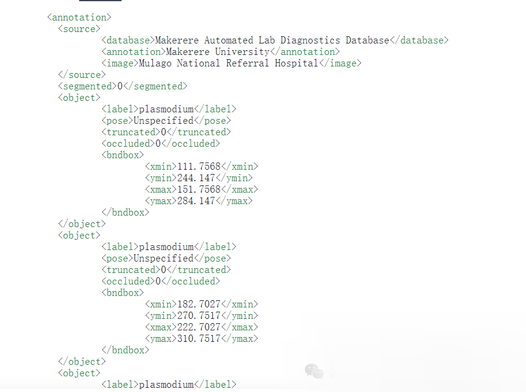

# [Dataset] [Object Detection] Malaria Plasmodium species target detection dataset VOC+YOLO format 948 images in 1 class

Dataset format: Pascal VOC format + YOLO format (txt file without split path, only containing jpg images and corresponding VOC format xml files and yolo format txt files)
Number of images (number of jpg files): 948
Number of annotations (number of xml files): 948
Number of annotations (number of txt files): 948
Number of annotation categories: 1
Annotation category names: ["plasmodium"]
Number of bounding boxes per category:
Plasmodium bounding box count = 7628
Total bounding boxes: 7628
Using labelImg for annotation
Annotation rules: Draw a rectangle around the category
Important note: Online similar datasets have issues with their annotations. This dataset has been specifically coded to fix these issues.
Special declaration: This dataset does not guarantee the accuracy or weights of the trained models or any other files. The dataset only provides accurate and reasonable annotations.

Annotation example:



Others' annotated files:



There are several errors in the above text. The labels Img annotate xmin, ymin, etc. as integers, and the standard category of labelImg is <name></name> which obviously cannot be read normally. Additionally, there are no critical information such as image width and height for annotation, which may increase the difficulty of script writing. After repairing it, it becomes as follows:

-
-
-
-
-
-
-
-
-
-
-
-
-
-
-
-
-
-
-
-
-
-
-
-
-
-
-
-
-
-
-
-
-
-
-
-
-
-
-
-
-
-
-
-
-
-
-
-
-
-
-
-
-
-
-
-
-
-
-
-
-
-
-
-
-
-
-
-
-
-
-
-
-
-
-
-
-
-
-
-
-
-
-
-
-
-
-
-
-
-
-
-
-
-
-
-
-
-
-
-
-
-
-
-
-
-
-
-
-
-
-
-
-
-
-
-
-
-
-
-
-
-
-
-
-
-
-
-
-
-
-
-
-
-
-
-
-
-
-
-
-
-
-
-
-
-
-
-
-
-
-
-
-
-
-
-
-
-
-
-
-
-
-
-
-

```
<annotation>        <folder>VOC</folder>        <filename>firc_plasmodium_1181.jpg</filename>        <path>C:/Users/Administrator/Desktop/data/JPEGImages/firc_plasmodium_1181.jpg</path>        <source>            <database>My Database</database>            <annotation>VOC2012</annotation>            <image>flickr</image>            <flickrid>NULL</flickrid>        </source>        <owner>            <flickrid>NULL</flickrid>            <name>company</name>        </owner>        <size>            <width>750</width>            <height>750</height>            <depth>3</depth>        </size>        <segmented>0</segmented>        <object>            <name>plasmodium</name>            <pose>Unspecified</pose>            <truncated>0</truncated>            <difficult>0</difficult>            <bndbox>                <xmin>253</xmin>                <ymin>83</ymin>                <xmax>293</xmax>                <ymax>123</ymax>            </bndbox>        </object>        <object>            <name>plasmodium</name>            <pose>Unspecified</pose>            <truncated>0</truncated>            <difficult>0</difficult>            <bndbox>                <xmin>242</xmin>                <ymin>117</ymin>                <xmax>282</xmax>                <ymax>157</ymax>            </bndbox>        </object>        <object>            <name>plasmodium</name>            <pose>Unspecified</pose>            <truncated>0</truncated>            <difficult>0</difficult>            <bndbox>                <xmin>498</xmin>                <ymin>0</ymin>                <xmax>538</xmax>                <ymax>40</ymax>            </bndbox>        </object>        <object>            <name>plasmodium</name>            <pose>Unspecified</pose>            <truncated>0</truncated>            <difficult>0</difficult>            <bndbox>                <xmin>566</xmin>                <ymin>7</ymin>                <xmax>606</xmax>                <ymax>47</ymax>            </bndbox>        </object>        <object>            <name>plasmodium</name>            <pose>Unspecified</pose>            <truncated>0</truncated>            <difficult>0</difficult>            <bndbox>                <xmin>299</xmin>                <ymin>275</ymin>                <xmax>339</xmax>                <ymax>315</ymax>            </bndbox>        </object>        <object>            <name>plasmodium</name>            <pose>Unspecified</pose>            <truncated>0</truncated>            <difficult>0</difficult>            <bndbox>                <xmin>382</xmin>                <ymin>332</ymin>                <xmax>422</xmax>                <ymax>372</ymax>            </bndbox>        </object>        <object>            <name>plasmodium</name>            <pose>Unspecified</pose>            <truncated>0</truncated>            <difficult>0</difficult>            <bndbox>                <xmin>396</xmin>                <ymin>577</ymin>                <xmax>436</xmax>                <ymax>617</ymax>            </bndbox>        </object>        <object>            <name>plasmodium</name>            <pose>Unspecified</pose>            <truncated>0</truncated>            <difficult>0</difficult>            <bndbox>                <xmin>580</xmin>                <ymin>572</ymin>                <xmax>620</xmax>                <ymax>612</ymax>            </bndbox>        </object>        <object>            <name>plasmodium</name>            <pose>Unspecified</pose>            <truncated>0</truncated>            <difficult>0</difficult>            <bndbox>                <xmin>676</xmin>                <ymin>102</ymin>                <xmax>716</xmax>                <ymax>142</ymax>            </bndbox>        </object>        <object>            <name>plasmodium</name>            <pose>Unspecified</pose>            <truncated>0</truncated>            <difficult>0</difficult>            <bndbox>                <xmin>439</xmin>                <ymin>159</ymin>                <xmax>479</xmax>                <ymax>199</ymax>            </bndbox>        </object>        <object>            <name>plasmodium</name>            <pose>Unspecified</pose>            <truncated>0</truncated>            <difficult>0</difficult>            <bndbox>                <xmin>540</xmin>                <ymin>177</ymin>                <xmax>580</xmax>                <ymax>217</ymax>            </bndbox>        </object>        <object>            <name>plasmodium</name>            <pose>Unspecified</pose>            <truncated>0</truncated>            <difficult>0</difficult>            <bndbox>                <xmin>513</xmin>                <ymin>221</ymin>                <xmax>553</xmax>                <ymax>261</ymax>            </bndbox>        </object></annotation>
```

The above format is standard VOC format and conforms to industry standards, and it is also less prone to errors when using other online scripts.


## Payment

Here is a pay link on Stripe ( https://buy.stripe.com/3cs8yP7sY87d0vu9AB ). Please contact me lonlonago@foxmail.com after funding $89, and I will send you a complete data files , thank you!


